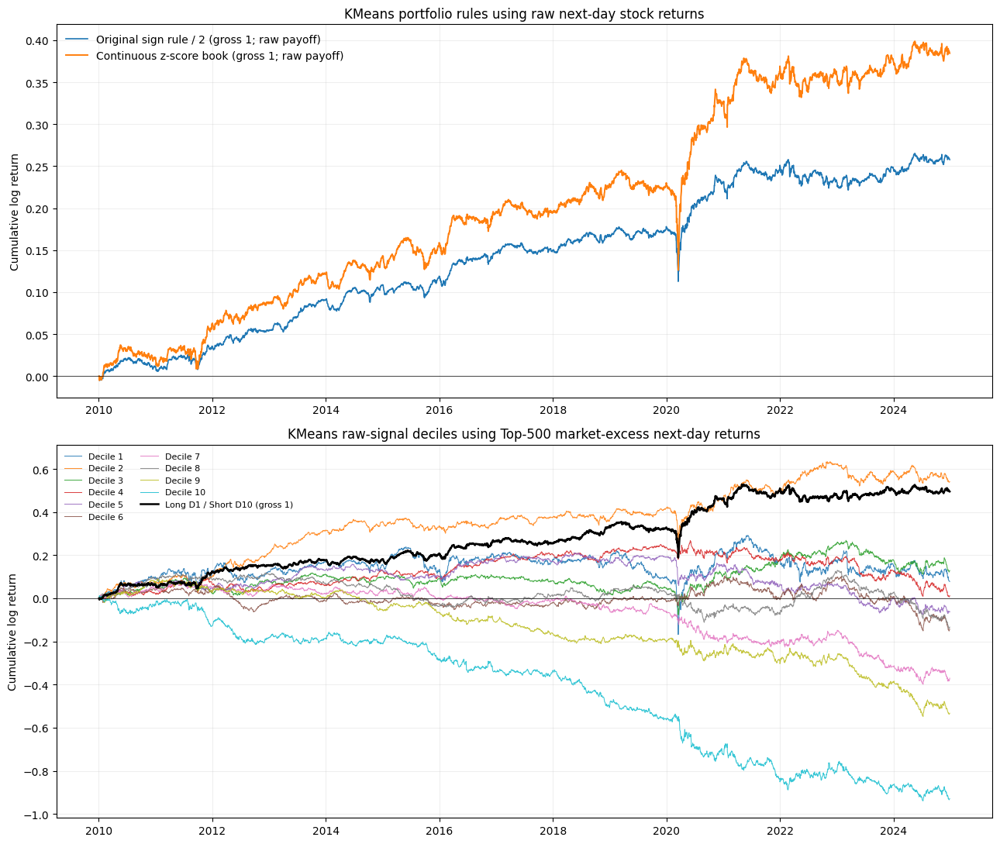
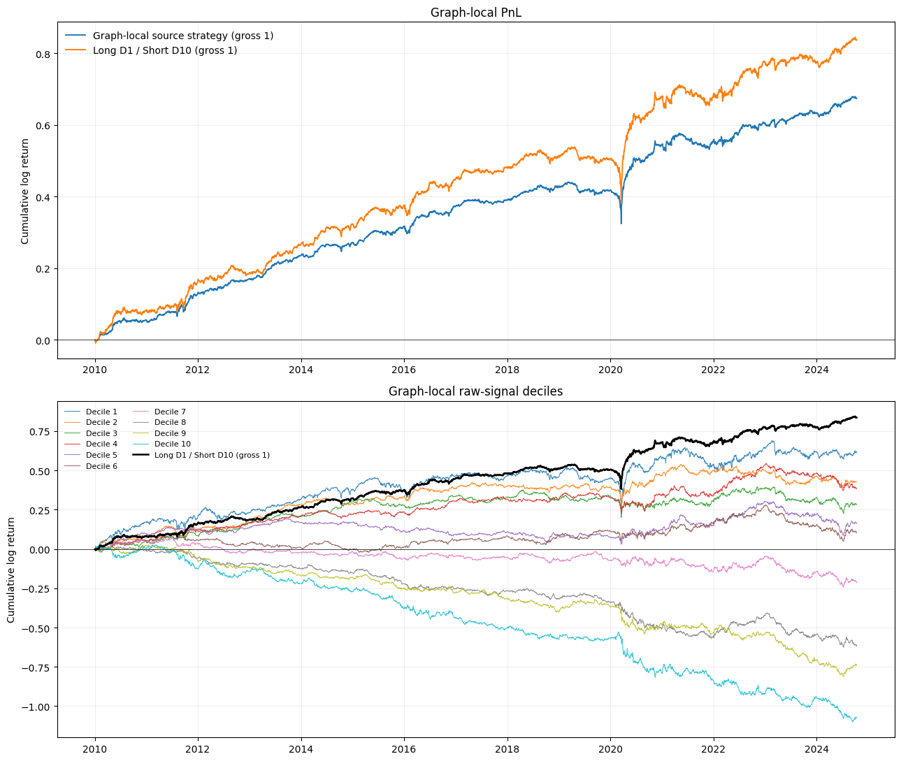

# KMeans and Graph-local statistical-arbitrage study

This project reproduces the clustering analysis in *Quantifying the
Contributions of Clustering in Statistical Arbitrage* and studies a graph-based
alternative from *Algorithms for Learning Graphs in Financial Markets*.

The question is deliberately regime-specific. Equity statistical arbitrage has
weakened materially since 2010, while the post-2010 period has contained a long
and unusually strong bull market. We therefore evaluate clustering as a
market-neutral strategy in that context: the clustering rule can change both
alpha and volatility, even when the return universe, signal horizon, and
portfolio construction are held fixed.

Replacing the KMeans benchmark with Graph-local produces the stronger result in
this experiment and a more monotonic decile pattern. The figures below show the
post-2010 cumulative log returns from the saved notebooks. KMeans deciles use
Top-500 market-excess next-day returns; Graph-local is evaluated with its
market-excess payoff construction.





This does **not** make Graph-local a finished standalone strategy. A stronger
setup needs better removal of common market risk and alpha-factor exposure, and
a better residual-extraction model. Attention-based latent-factor models or
asset-embedding methods are promising directions. That missing residual model
is the main limitation of the present setup.

## Reproducible workflows

- `notebooks/01_benchmark_comparison.ipynb`: KMeans reproduction. Part 1
  displays the original repository's sign-and-equal-weight book (gross 2).
  Part 2 applies the same raw scores under a 1%-winsorized cross-sectional
  z-score rule with gross 1 and net 0, then displays market-excess deciles.
- `notebooks/02_graph_local.ipynb`: saved FinGraph graph-local weights,
  gross/net checks, metrics, cumulative-log PnL, and deciles.

The notebooks use a row labelled `signal_date=t` with an already aligned
realised `t+1` payoff. They do not shift returns a second time.

## KMeans workflow

`local/run_lightweight_cpu.py` builds daily KMeans partitions and evaluates the
original repository's `naive_stream` betting rule. It requires the compact
Top-500 cache created by `local/build_t_aligned_sic_cache.py`; the cache lives
in the Docker `statarb-cache` volume. `local/export_kmeans_daily_books.py`
exports the continuous raw signals, original weights, and `t+1` returns.
`local/build_kmeans_next_day_market_return.py` builds the corresponding
Top-500, `DlyCap[t]`-weighted `t+1` market return used only by the KMeans
decile diagnostic. The notebook's own rule is implemented in
`local/decile_analysis.py` and can be cached with:

```sh
python local/build_continuous_weight_pnl.py \
  --books data/derived/t_aligned_kmeans/market/kmeans_market_daily_books.csv.gz \
  --out data/derived/t_aligned_kmeans/market/kmeans_market_zscore_gross1_daily_pnl.csv \
  --score-column raw_signal --winsor 0.01
```

## Graph-local workflow

See `local/README_graph_local.md`. The scripts for refitting graphs, exporting
them, and applying the graph-local signal are retained in `local/`. The
notebooks' committed output renders on GitHub; local data products are rebuilt
from licensed inputs.

## Data availability

The repository does not distribute CRSP, Compustat, CCM, or files derived from
them. GitHub renders the committed notebook output, while a local rerun requires
a separately licensed CRSP-compatible panel under `data/derived/ciz_compat_panel/`.
The scripts rebuild caches, books, and PnL locally. See [data/README.md](data/README.md)
for the data policy and the two workflow READMEs for commands.
